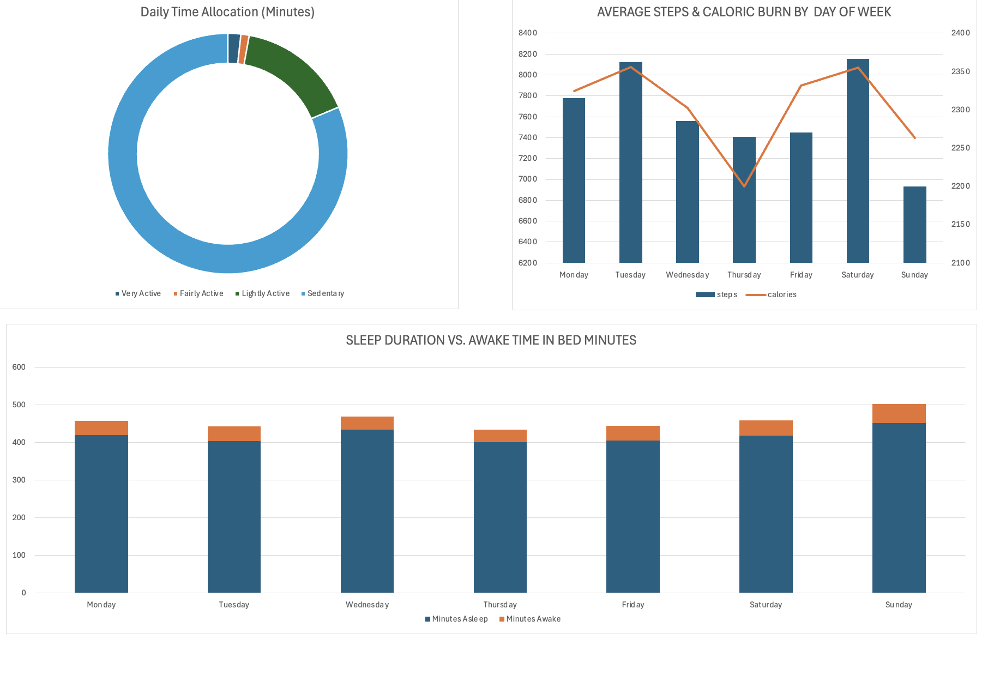

# Bellabeat Smart Device Usage Analysis

## 1. Executive Summary
Bellabeat manufactures health-focused smart products designed for women. This analysis investigates consumer habits from public smart-device tracking data (Fitbit Fitness Tracker Dataset) to identify user activity, caloric expenditure, and sleep patterns.

* **Severe Sedentary Time:** Users log an average of **991 minutes (16.5 hours)** of sedentary time per day, representing **~81%** of total tracked daily hours.
* **Activity & Burn Disconnect:** Activity peaks midweek (Tuesday) and on Saturdays, dropping significantly on Thursdays and Sundays.
* **Sleep Latency & Bedtime Restlessness:** While users average **419 minutes (~7 hours)** of sleep per night, they spend an average of **39 minutes awake in bed**, with restlessness peaking on weekends (51 minutes awake on Sunday).

## 2. Business Objectives
* **Analyze:** How do consumers use non-Bellabeat smart devices in their daily routines?
* **Identify:** What behavioral patterns and pain points emerge across movement, intensity levels, and sleep?
* **Recommend:** How can these insights guide Bellabeat’s product features and marketing strategy for the **Bellabeat Leaf** and the **Bellabeat App**?

## 3. Data Processing & Methodology
* **Tool:** Microsoft Excel (macOS)
* **Data Sources:** `dailyActivity_merged.csv` and `sleepDay_merged.csv` (FitBit Fitness Tracker Data, Public Domain)
* **Data Cleaning & Transformation:**
  * Standardized date strings across datasets into uniform datetime values (`YYYY-MM-DD`).
  * Engineered a composite primary key (`User_Date_Key` = `Id & "_" & ActivityDate`) to execute relational lookups between activity logs and sleep records.
  * Calculated derived behavioral metrics (`SedentaryHours`, `AwakeMinutesInBed` = `TotalTimeInBed - TotalMinutesAsleep`).
  * Built dynamic Pivot Tables and linked summary tables to construct dual-axis combo charts and stacked column visualizations.

## 4. Key Analytical Insights

| Analysis Area | Key Metric | Behavioral Finding |
|---|---|---|
| **Daily Time Allocation** | 991 mins / 16.5 hrs Sedentary | Sedentary behavior accounts for **81%** of tracking time, while "Very Active" movement represents only **21 minutes (~1.7%)** daily. |
| **Weekly Step Volume** | 8,125 steps (Tue) vs. 6,933 steps (Sun) | Users fall short of the 10,000 daily step benchmark, showing notable drop-offs on Thursdays and Sundays. |
| **Sleep Efficiency** | 39 mins avg. awake in bed | Users experience 34–51 minutes awake in bed, indicating pre-sleep restlessness or bedtime screen habits. |

## 5. Strategic Recommendations for Bellabeat
1. **"Inactivity Break" Smart Alerts (Bellabeat App & Leaf):** Program gentle haptic vibrations through the Leaf tracker after 50 consecutive minutes of inactivity during daytime hours (9:00 AM – 6:00 PM).
2. **Personalized "Wind-Down" Routine:** Introduce an automated evening prompt in the Bellabeat App 45 minutes before target bedtime offering guided meditation and breathing exercises.
3. **Weekend Engagement Challenges:** Launch in-app community challenges (e.g., *"Sunday Reset Stroll"*) incentivized with wellness rewards to counter Sunday activity drops.
